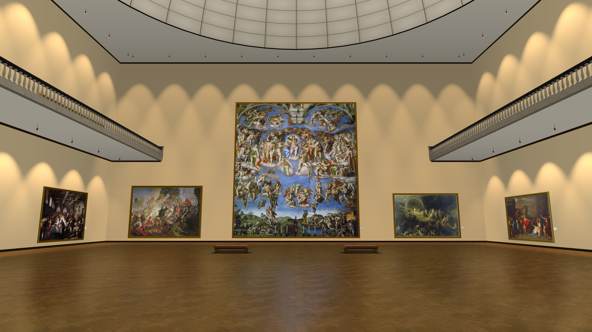
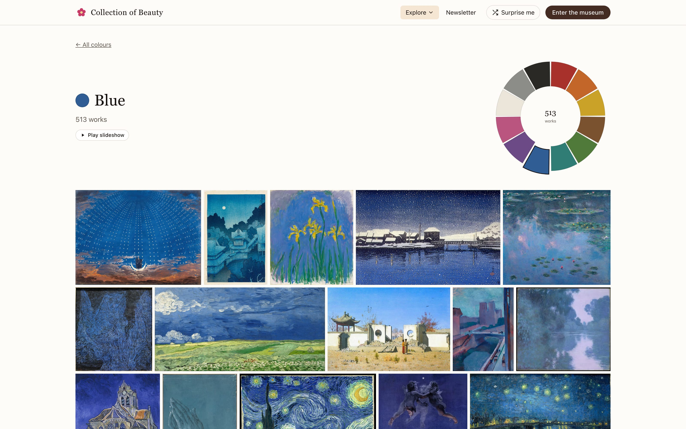
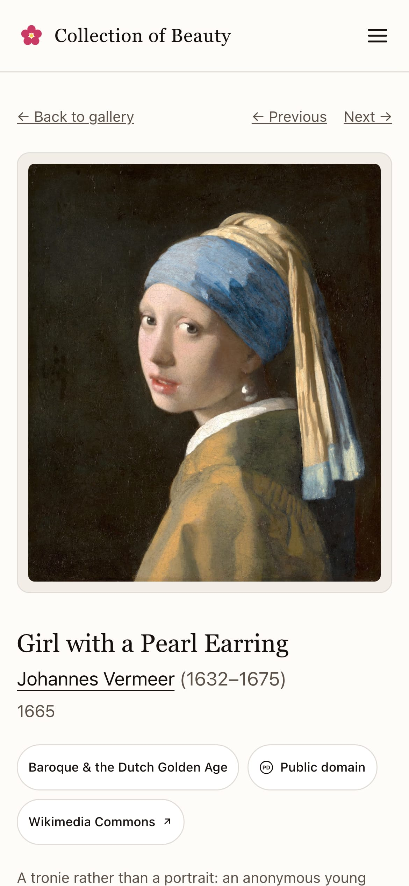

# Collection of Beauty

[collectionofbeauty.com](https://collectionofbeauty.com) holds 4,000+ handpicked public-domain paintings, prints and book plates by 300+ artists.
You can browse them by era, artist, colour or decade, or walk a 3D museum of four floors in your browser.

[Rico Trebeljahr](https://ricos.site) made it.
Journalists can find images and facts in the [press kit](https://collectionofbeauty.com/press).
If you spot a wrong date, title or attribution, please [open an issue](https://github.com/trebeljahr/collection-of-beauty/issues).

<a href="https://collectionofbeauty.com/gallery-3d"></a>

<a href="https://collectionofbeauty.com/colours/blue"></a>
<a href="https://collectionofbeauty.com/artwork/collection-of-beauty-1665-girl-with-a-pearl-earring"></a>

## What you can do there

- **Browse** the works by [era](https://collectionofbeauty.com/eras), [artist](https://collectionofbeauty.com/artists), [colour](https://collectionofbeauty.com/colours) or [decade](https://collectionofbeauty.com/timeline), or open [one at random](https://collectionofbeauty.com/surprise).
- **Walk the [3D museum](https://collectionofbeauty.com/gallery-3d).**
  Its four floors are Old Masters, Salon and Academy, Impressionism and After, and Natural History and East Asian Art.
  They stand round a court that is open through all of them, joined by two grand staircases and a spiral stair.
  1,400+ works hang there in their own frames, at their real size where it is known.
  You walk with the keyboard and mouse, or with an on-screen joystick on a phone, while 13 public-domain or freely licensed recordings play.
- **Download** any work in every size built for it. 1,100+ works come from scans wider than 4,096 px and download at full resolution, up to 16,384 px.
- **Read four illustrated books** in their plate order under [Collections](https://collectionofbeauty.com/collections): Audubon's *Birds of America*, Haeckel's *Kunstformen der Natur*, and Redouté's *Les Roses* and *Les Liliacées*.
- **Get [Drops of Beauty](https://collectionofbeauty.com/drops)**, a newsletter with five works on one theme in each edition.

The site is free, with no account and no ads.

## Run it locally

You need Node 24 or later and pnpm 10.

```sh
pnpm install
pnpm dev   # Next on :3547 + a local asset server on :9837
```

`pnpm dev` spawns `scripts/serve-assets.mjs` alongside Next; it serves
`assets-web/` straight from disk on :9837 and replaced the old
rclone-in-docker container (`docker-compose.yml` now only describes the
deployed app). If you don't have `assets-web/` locally, point the site at
the production bucket instead — `pnpm dev:r2`, or set
`NEXT_PUBLIC_ASSETS_BASE_URL` yourself — otherwise the gallery pages
render with broken images.

## About the code

A public-domain art gallery built as a Next.js App Router site, with a
WebGL multi-floor museum, a curated newsletter, and a pre-built
asset pipeline (no Next image optimizer in the hot path).

### Stack

- **Next.js 16** (App Router, Server Components, RSC)
- **R3F / Three.js** for the 3D gallery (`/gallery-3d`), lazy-loaded with `ssr: false`
- **Tailwind 4** + a small shadcn/ui-style `components/ui/` set
- **Biome** for format + lint, **vitest** for unit tests
- Pre-resized AVIF/WebP variants served from **Cloudflare R2** via `rclone`
- Deployed as a **static export** (`output: "export"`) on a Cloudflare Worker
  with static assets and no code; the newsletter and downloads run in a
  small API Worker ([`workers/api`](workers/api)). See
  [`docs/static-site.md`](docs/static-site.md).

### Asset pipeline

```
assets/                 # originals, untouched
  └── audubon-birds/foo.jpg ...
assets-web/             # pre-built variants emitted by shrink
  └── audubon-birds/foo/{256,480,640,960,1280,1920,2560,4096}.avif
                          1280.webp           # the ladder — every rung, every source
                          <fullW>.avif        # only when the full-size encode clears
                                              # FULL_SIZE_MIN_WIDTH (4096 px)
                          tiles/<level>/<col>_<row>.webp
                                              # deep-zoom pyramid, same condition
                          6144.avif           # 3D gallery close-up LOD, only when
                                              # <fullW> is strictly larger than 6144
src/data/               # baked JSON the runtime reads
  artworks.json, artists.json, ...
```

Commands:

| Command | What it does |
| --- | --- |
| `pnpm assets:shrink` | Build AVIF + WebP variants from `assets/` into `assets-web/`. Idempotent. |
| `pnpm assets:tiles` | Build Deep Zoom (DZI) tile pyramids for the ~967 sources that earned a full-size AVIF, so the lightbox can zoom to brushstroke level. Idempotent. Reads `src/data/artworks.json`, so run it **after** `assets:build-data`. |
| `pnpm assets:build-data` | Walk metadata + `assets-web/` and bake `src/data/*.json` consumed by every page. |
| `pnpm assets:sync` | Mirror `assets-web/` to the R2 bucket via rclone. |
| `pnpm assets:verify` | HEAD-check every catalogued variant against the public R2 URL. Run by hand; needs no R2 creds. Pass `--sample 200` for a smoke test, `--check-unshrunk` to also fail on `variantWidths===null` entries. |
| `pnpm assets:verify:bulk` | Same check but lists R2 in one `rclone lsf` pass and verifies set membership. ~10× faster than HEAD-spray; needs R2 creds from `.env.production`. This is the drift gate: `.husky/pre-push` runs it whenever `src/data/artworks.json` is part of the push (it replaced a CI job that false-failed on rate limits). |
| `pnpm assets:prepare` | The full chain: shrink → build-data → tiles → sync. |

You should run `pnpm assets:build-data` whenever you change metadata,
add an artwork, run the shrink pipeline against new originals, or
adjust the variant width ladder. Without it the runtime won't pick up
new variants.

### Development commands

| Command | What it does |
| --- | --- |
| `pnpm dev` | Next dev server (Turbopack) + local asset server on :9837 fronting `assets-web/`. |
| `pnpm dev:r2` | Same dev server, but with `NEXT_PUBLIC_ASSETS_BASE_URL` set so `<picture>` URLs point at the production R2 bucket. Useful for spotting catalogue ↔ bucket drift before the pre-push check does. Skips the local :9837 server. |
| `pnpm build` | Static export into `out/`, then `_redirects` and `_headers` (`scripts/write-static-routing.mts`). |
| `pnpm build:analyze` | Build with `@next/bundle-analyzer` enabled. HTML reports in `.next/analyze/`. |
| `pnpm preview` | Serve `out/` the way the Worker does (`wrangler dev`, port 49731 or `$PORT`). |
| `pnpm dev:api` | The API Worker under `wrangler dev` on :8790; `pnpm dev` proxies `/api/newsletter` and `/api/download` to it. |
| `pnpm typecheck` | `next typegen`, then `tsc --noEmit` over `src/` + `tests/`, then again over `scripts/` via `tsconfig.scripts.json`. |
| `pnpm test` | Run the vitest suite (pure logic). |
| `pnpm test:watch` | Vitest in watch mode. |
| `pnpm test:coverage` | Coverage report (v8). |
| `pnpm format` / `pnpm lint` / `pnpm check` | Biome. |

The pre-commit hook (husky + lint-staged) runs `biome check --write`
on staged files only; the pre-push hook runs the R2 drift check, and
only when the catalogue changed. Typecheck and tests are gated in CI
(see [Deployment](#deployment)).

### Architecture quick map

- `src/app/` — App Router pages. The `/artwork/[id]` detail page and the
  newsletter edition pages read the full `Artwork` type server-side;
  anything handed to a client component is the slim `ArtworkListing`
  projection from `src/lib/data.ts`, which keeps the RSC payload small
  (artworks.json is ~6 MB).
- `src/lib/gallery-layout/` — the museum's floor plan and hang, as pure
  functions that take an `ArtworkListing[]` and return each floor's rooms,
  doors and painting placements. `layout-block.ts` is the plan: one block
  on four floors round an open court. `grand-stair.ts` holds its
  staircases and `giants.ts` hangs the works too large for a room.
  Covered by unit tests.
- `src/components/gallery-3d/` — the WebGL museum. Lazy-loaded from
  `src/app/gallery-3d/gallery-3d-client.tsx`. Has its own readme in
  the directory headers — start with `index.tsx`.
- `src/components/gallery-3d/painting-registry.ts` — bounded raycast
  target list, so aim/click doesn't traverse hundreds of meshes.
- `src/components/gallery-3d/texture-cache.ts` — LRU + rAF-paced GPU
  upload queue for the painting textures.
- `src/lib/seo.ts`, `src/app/sitemap.ts`, `src/app/robots.ts` — SEO
  surface. Sitemap is revalidated daily.
- `content/newsletter/NNNN-<theme>.md` — newsletter editions, one
  markdown file per issue. Frontmatter + body. The git history is the
  archive; there is no state file. See
  [`content/newsletter/README.md`](content/newsletter/README.md).
- `src/app/drops/` + `src/app/newsletter/` — the public archive. `/drops`
  is the index and `/newsletter/<slug>` the canonical edition page; the
  other half of each pair (`/newsletter`, `/drops/<slug>`) is a permanent
  redirect kept so older links resolve.
- `src/lib/newsletter/` — edition loader, email render, subscribe-flow
  HMAC + rate limit, ListMonk HTTP client.
- `src/app/api/newsletter/{subscribe,confirm}/` — only the
  user-facing double-opt-in routes. **Sending is CLI-only** — see
  `pnpm sendNewsletter`. There is no cron, no scheduled task, no
  send API route.
- `scripts/newsletter-draft.ts` / `scripts/newsletter-send.ts` — the
  CLI surface. `pnpm newsletter:draft <slug>` scaffolds a new issue;
  `pnpm sendNewsletter` sends the latest published issue against
  `.env.development` (the test list); `pnpm sendNewsletter <slug>`
  sends a specific issue; `--dry-run` renders without sending; prefixing
  `NODE_ENV=production` switches to `.env.production` (the live list).
  `pnpm newsletter:send` remains an alias. Env-file selection happens
  in `scripts/newsletter-send.sh`.


### Newsletter delivery

Subscribers and sending live in a self-hosted ListMonk instance that
delivers through Amazon SES. The app talks only to ListMonk's HTTP API.
How the emails are rendered, which env vars the app reads and how to set
up the templates: [`docs/newsletter-delivery.md`](docs/newsletter-delivery.md).

### Deployment

On push to `main`, CI runs typecheck, unit tests and release contract tests,
exports the site, carries the last two releases' chunks into it, and uploads
a version of both Workers tagged with the commit: the site (static files, no
code) and the API Worker in [`workers/api`](workers/api) (newsletter signup,
confirm and unsubscribe, filenamed downloads). Nothing deploys until the
repository variable `COLLECTION_OF_BEAUTY_SITE_ROLLOUT_MODE` is set;
`automatic` then activates both and checks the public site, `manual` waits
for a dispatch of operation `deploy`. Routes, rollback and limits:
[`docs/static-site.md`](docs/static-site.md).

### Marketing images

The press images, museum screenshots, site screenshots and the GitHub
social preview card are made by scripts (`pnpm marketing:*`).
[`docs/marketing/README.md`](docs/marketing/README.md) lists every file,
its size and how to make it again.

### Notes for AI coding agents

See [`CLAUDE.md`](CLAUDE.md) for the per-project agent notes (worktree
conventions, gotchas, what NOT to touch).

## Corrections

Every work's page has a *Suggest a fix* link that opens a pre-filled
GitHub issue. If you don't use GitHub, email hello@collectionofbeauty.com
with the work's title and what is wrong.

## License

The code is licensed under the
[GNU Affero General Public License v3.0 or later](LICENSE)
(AGPL-3.0-or-later). Copyright © 2026 Rico Trebeljahr.

The licence covers the code only. Everything else keeps its own terms:

- **The artworks** are in the public domain. Their images and metadata come
  mostly from Wikimedia Commons and Wikidata, plus a few works from the
  Library of Congress. Each work's page links its source, where you can
  check the rights statement. 91 of the 4,555 images are photographs under
  a Creative Commons licence (CC BY or CC BY-SA), and the work's page names
  it.
- **Rico's own writing, curation texts and photos**, such as the page texts,
  the work descriptions and the newsletter editions in `content/newsletter/`,
  are © Rico Trebeljahr, all rights reserved.
- **The press images and screenshots** in `public/marketing/` and
  `docs/marketing/screenshots/` are CC0, as the
  [press page](https://collectionofbeauty.com/press) states.
- **Third-party assets** keep their licences. The textures in
  `public/textures/` are CC0, from [Poly Haven](https://polyhaven.com). The
  museum's 13 recordings are in the public domain or under CC0, CC BY or
  CC BY-SA, and are credited at
  [/gallery-3d/music](https://collectionofbeauty.com/gallery-3d/music) and in
  [`src/lib/gallery-music.ts`](src/lib/gallery-music.ts).
  [`public/audio/CREDITS.md`](public/audio/CREDITS.md) names the source of
  the room-transition sound. npm dependencies are under their own licences.
  The site uses system fonts and ships no font or 3D model files.

## Support

Collection of Beauty is free and has no ads. If you want to support it, you
can [donate on ricos.site](https://ricos.site/donate).
